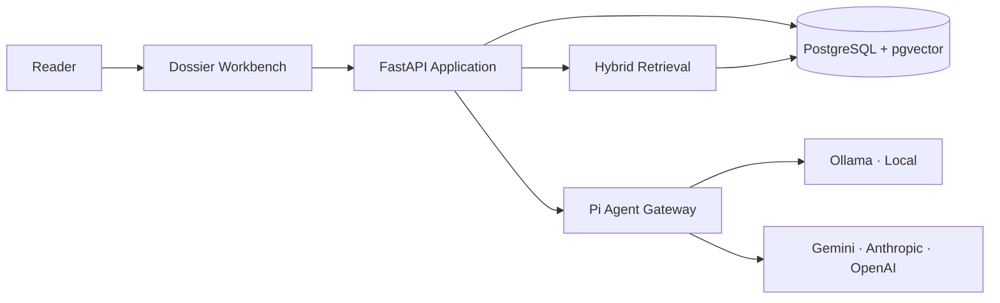
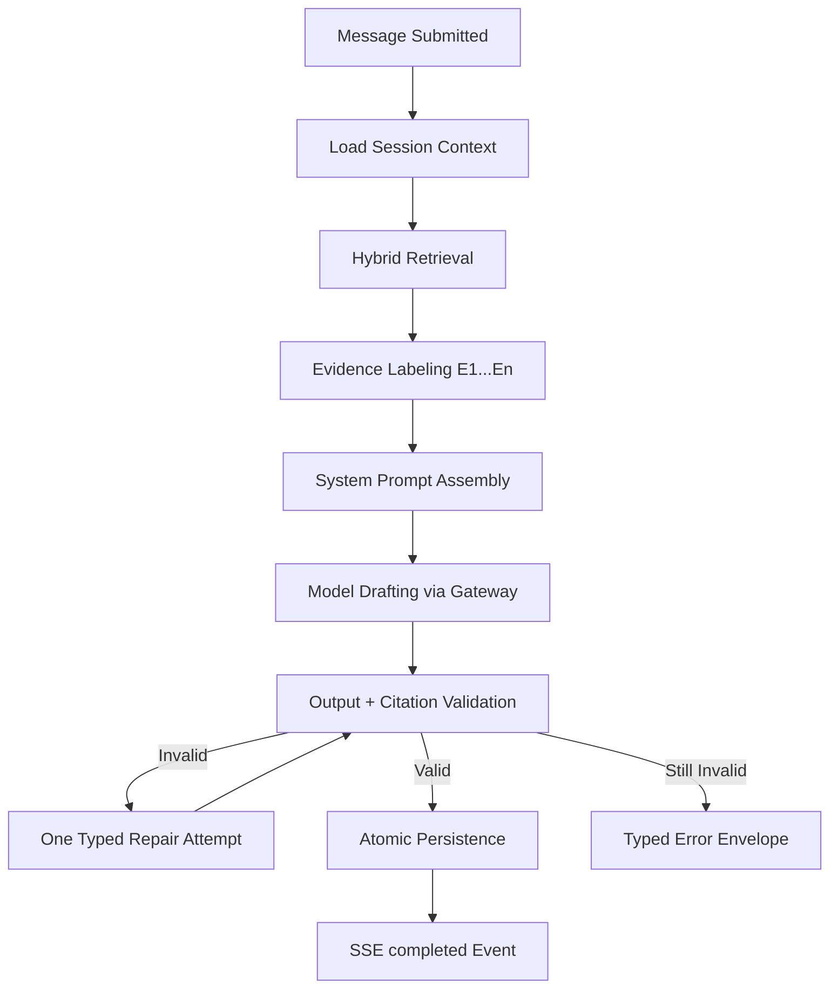
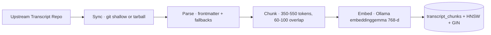
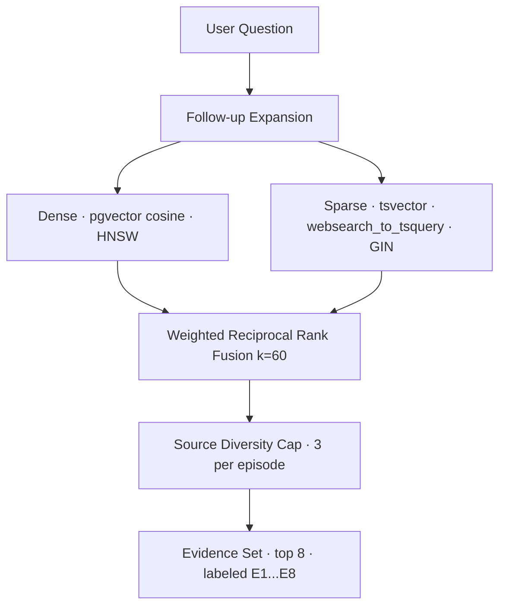
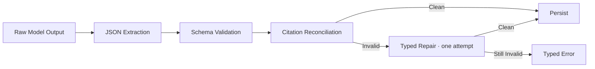
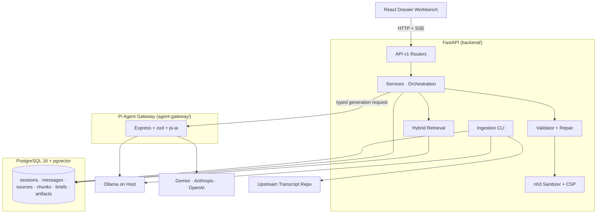

<div align="center">

<h1>Kestrel</h1>

<h3>The Lenny Growth Assistant</h3>

<p>
  An evidence-first growth research workbench that turns Lenny's Podcast
  transcripts into grounded answers, structured Growth Briefs,
  Ship 30 for 30 essays, and sandboxed visual deliverables —
  with 100% source provenance.
</p>

<br />

<a href="https://github.com/imshreyaskn/kestrel">
  
</a>


</div>

---

## Overview

Kestrel is a conversational growth-research companion for product leaders, growth operators, and founders.

It pairs two kinds of intelligence: **archive knowledge** — what Lenny's Podcast guests actually said, retrieved from the transcript corpus and cited down to the exact passage — and **the assistant's own reasoning**, clearly labeled, built on top of that evidence.

Every answer, brief, essay, and artifact is traceable to stored transcript chunks. Nothing is invented silently: when the archive cannot support a claim, Kestrel says so and shows the gap instead of filling it.



---

# How It Works

A message entering Kestrel passes through a deterministic pipeline. The model is never responsible for fetching its own evidence — retrieval, validation, and persistence are owned by the backend.



Each phase is streamed to the UI as a Server-Sent Event, so the reader watches the work happen:

```text
run_started   →  stage: loading_context  →  stage: retrieving
              →  stage: drafting         →  stage: validating
              →  stage: saving           →  completed
```

A 15-second heartbeat keeps long generations alive through proxies.

Striking a run cancels the stream, marks the assistant row `cancelled`, and persists nothing — partial drafts never become answers.

---

# Workflow Modes

The UI provides deterministic mode actions. The backend validates the mode explicitly and never relies on implicit model classification.

| Mode | Output | Contract |
|---|---|---|
| `research` | Grounded answer with inline `[E#]` citations | Answer-first, proportional depth, honest-gap shape when evidence is thin |
| `growth_brief` | Structured five-section brief persisted to the workbench | Problem → research summary → recommendation → experiment plan → risks, with guardrail metric and decision rule |
| `essay` | Ship 30 for 30 digital essay | ~1,250 words, hard-validated 1,150–1,350 (or an explicit user target), one of four writing paths |
| `artifact_markdown` | Standalone Markdown document ("plate") | Publication-grade craft rules, secure sandboxed Mermaid diagrams where structure helps |
| `artifact_html` | Complete HTML/CSS document | Self-contained, script-free, sanitized with nh3 and sandboxed on render |

---

# The Dossier Experience

The frontend is an **editorial research dossier** — a column of prose with a margin of apparatus, not a chat template.

* **Manuscript column** — queries and answers set as folio entries with drop caps, roman-numeral sections, and oldstyle numerals.
* **Margin sidenotes** — citations live in the margin as collapsed chips; hovering a bead peeks the quote in place, clicking expands the full note and draws the leader line.
* **Leader lines** — hand-drawn bezier curves connect each in-text bead to its margin note. Calm at rest, ink-drawn on arrival, hot-highlighted as one object across bead, line, note, and paragraph. Driven by non-ratcheting SVG percentage sizing (`width: 100%`, `height: 100%`) so parent scroll height never sticks to historical maxima.
* **Right-Side Deliverables Shelf (Folio Dock)** — bound Growth Briefs and visual Plate deliverables live on a dedicated right-hand shelf. Features **progressive disclosure** (completely hidden when 0 deliverables exist in the session) and **collision avoidance** (smoothly glides down to `top: 310px` when the Colophon model-selector opens, returning to `top: 70px` when closed).
* **The Fold** — Growth Briefs open as a 3D paper fold with editable sections, evidence/synthesis/user-context badges, and optimistic version locking.
* **Plates & Sandboxed Mermaid** — Markdown and HTML artifacts render beside the chat in the margin and in a full viewer with Preview/Source toggle. Mermaid diagrams in Markdown plates render inside opaque-origin sandboxed iframes (`sandbox="allow-scripts"` with CSP `default-src 'none'; style-src 'unsafe-inline'`), styled to Kestrel's editorial palette.
* **Continuous Folio & Endmark** — rationalized bottom padding ensures clean editorial breathing room above the fixed bottom composer bar without awkward empty whitespace below the `End of folio` stamp.

## One number, one truth

Citations use a single numbering system end to end: the retrieval rank.

```text
[E3] in the answer text  =  bead 3  =  margin note 3  =  rank 3 in the database
```

* Evidence labels `E1…En` are assigned by fused retrieval rank, per run.
* Invalid labels are stripped; labels the model used in text but forgot in its citations array are **auto-added** — every marker you can see is clickable, and every note has a marker.
* Excerpts are always read from the stored transcript chunk, never from model-generated quote text.
* Each note exposes its provenance: retrieval rank and fused RRF score.
* Numbering is stable across reloads — history is ordered by rank, and stale markers from earlier turns are stripped from replayed context so `E1` never means two different passages.

---

# Knowledge Base

## Ingestion

Transcripts are synced from the upstream repository, parsed, chunked, embedded, and indexed by a repeatable CLI pipeline.



* **Idempotent** — SHA-256 content hash per source; unchanged files skip embedding entirely.
* **Durable volume persistence** — all 303 episodes and 16,964 chunks reside in a dedicated Docker named volume (`postgres_data:/var/lib/postgresql/data`), fully surviving container reboots, rebuilds, and daemon restarts.
* **Durable provenance** — re-ingesting a changed episode soft-deactivates old chunks (`is_active = FALSE`) instead of cascade-deleting them, so citations in historical answers keep resolving to the exact text they supported.
* **Safe reconciliation** — sources that disappear upstream are marked inactive (excluded from retrieval, never erased); an empty discovery set can never wipe the corpus.
* **Isolated failures** — per-file savepoints: one broken transcript cannot poison the run; failures are counted and reported.
* **Local transcript cache** — raw upstream transcripts are mirrored in `transcripts-cache/` on disk for offline re-indexing.

```bash
make ingest          # sync upstream + index
make ingest-check    # knowledge base stats
make reindex         # force full re-index (embedding model changes)
```

## Hybrid retrieval

Every question is answered from a bounded, ranked evidence set — never from the whole corpus, never from model memory.



* **Dense + sparse fusion** — weighted RRF (0.6 dense / 0.4 sparse) merges semantic and keyword recall without mixing incompatible score scales.
* **Follow-up aware** — short or anaphoric queries ("why does he put retention first?") are deterministically expanded with prior-turn context before retrieval.
* **Honest sufficiency** — empty retrieval yields an explicit insufficient-evidence state; a weak-evidence advisory flag is recorded when the best dense score is marginal.
* **Request-scoped labels** — `E1…En` exist only for the run; the backend maps them to canonical chunk IDs and episode metadata. The model never invents database IDs or URLs.

### Retrieval evaluation

A curated 20-case fixture (`docs/evaluation/retrieval_cases.yaml`) spans factual, semantic, framework, multi-episode, follow-up, unsupported, nuanced, and typo queries.

```bash
make benchmark       # live run against real embeddings (requires Ollama + ingested corpus)
make benchmark-ci    # CI run with the deterministic fake embedder (fake index only)
```

The spec target is ≥ 80% relevant-source Recall@5. These are **target gates, not claimed results** — run the benchmark against your own ingested corpus to see actual numbers.

---

# Agent Layer

## Prompt architecture

The system prompt is assembled per turn from versioned parts:

* **Base instructions** — identity, three-tier epistemics (archive facts cite `[E#]`; the assistant's own reasoning is welcome but labeled; user product context is fenced), untrusted-data framing, proportional answers, capability card, strict JSON contract.
* **Mode instructions + output schema** — one per workflow mode.
* **Runtime skills** — loaded from `runtime-skills/`, versioned, and stamped into message metadata:
  * `ship-30-for-30` — the essay craft contract (hooks, 4A writing paths, rate of revelation, grounding rules, word bounds).
  * `document-craft` — the deliverable style constitution (typography, tables, mermaid usage, and an explicit ban list: no emoji, no gradients, no glassmorphism, no AI-recap voice).
* **Evidence block** — the run's labeled passages, embedded in the system prompt above untrusted user content.

Transcript excerpts and conversation history are treated as **untrusted data, not instructions** — embedded commands in transcript text are explicitly refused.

## Validation & repair

Model output is never trusted structurally or factually:



* A hardened extractor handles real small-model behavior — reasoning tags, markdown fences, conversational preambles.
* **Citation reconciliation** — hallucinated evidence IDs are stripped, inline labels the model forgot to list are auto-added, and dangling markers never reach the reader.
* **Typed repair** — the single retry is told the *actual* failure reason (`JSON_PARSE`, `ESSAY_LENGTH`, `EMPTY_ANSWER`, `INVALID_LABELS`, `TRUNCATED`, `ARTIFACT_STYLE`) instead of a generic complaint.
* **Truncation detection** — the provider's stop reason is propagated; a cut-off response is repaired with concision guidance, not re-run blind.
* **Essay length gate** — outside the accepted band the draft is rejected rather than persisted; an explicit user word target re-bands the gate.

## Gateway

A thin Node 22 service (`agent-gateway/`) built on the **Pi AI SDK** (`@earendil-works/pi-ai`) owns provider routing and nothing else.

* Internal-only: not published to the host, authenticated with a shared token, **fail-closed** when unconfigured, timing-safe comparison.
* Model allowlists enforced at two layers (backend + gateway); client-supplied model IDs are never trusted, never silently substituted.
* Provider-aware context and output limits: Ollama requests carry an explicit `num_ctx` (default 16384) and `num_predict`; cloud providers get per-provider output caps from the model catalog.
* Deterministic retrieval by design (spec §6.6 / ADR-001): no shell, no filesystem, no browsing tools — the product agent has exactly one job, and its evidence is fetched for it.

## Providers

| Path | Provider | Default model | Notes |
|---|---|---|---|
| Local (mandatory for demo) | Ollama on host | `qwen2.5:1.5b` | Chat; `embeddinggemma` (768-d) powers retrieval |
| Cloud | Google Gemini | `gemini-3.5-flash-lite` | `.env.example` suggests `gemini-3.8-flash` as the production workhorse |
| Cloud | Anthropic | `claude-sonnet-5` | Must be a catalog ID — `claude-sonnet-latest` is **not** in the Pi AI catalog |
| Cloud | OpenAI | `gpt-4o` | |

Provider switching is explicit and user-initiated — the system never silently falls back from local to cloud.

**Model tier guidance:** the 1.5B local model reliably handles research turns with the hardened extractor. Essays (1,150–1,350 words of structured JSON) declare `min_model_tier: mid` — use a larger local model or a cloud provider for consistent essay quality.

---

# Artifact Security

Generated HTML is **untrusted by construction**. The rendering contract is deliberately explainable:

| | Permitted | Blocked |
|---|---|---|
| Markup | A documented allowlist of 68 static tags (typography, tables, figures, lists) | `script`, `iframe`, `form`, `embed`, `object`, `meta refresh`, all event-handler attributes |
| URLs | `http(s)`, `mailto`, `data:`, `blob:` — with forced `rel="noopener noreferrer"` | `javascript:` and every other scheme |
| CSS | Local inline styles and `<style>` blocks | `@import`, external `url(...)`, `expression()`, `behavior:` |
| Execution | Nothing | Scripts, network calls, forms, popups, downloads, top navigation, same-origin access |

**Why:** the preview renders inside `<iframe sandbox="">` (no `allow-scripts`, no `allow-same-origin`) with a `default-src 'none'` CSP injected into the document itself. Sanitization runs server-side at save time with **nh3** (Rust/ammonia allowlist sanitizer); the browser receives an already-sanitized preview derivation and the original stays available in the Source view. Interactive JS artifacts are intentionally out of scope for v1 — that would be a separate security decision.

**Mermaid diagrams** (Markdown deliverables) render through a pinned `mermaid@11.x` at `securityLevel: 'strict'`, with in-band `%%{init}%%` directives stripped before rendering, and the resulting SVG displayed inside an opaque-origin sandboxed frame (`sandbox="allow-scripts"` with CSP `default-src 'none'; style-src 'unsafe-inline'`) — diagram markup never enters the parent app DOM.

**Markdown answers** render through a custom zero-dependency parser that emits React elements only — raw HTML in model output is escaped, never injected.

---

# Architecture



**Boundaries:** the backend owns identity, persistence, retrieval, citation mapping, validation, and provider policy. The gateway owns provider translation and limits. The frontend owns presentation and states. Models do not authorize their own actions, mint IDs, or fetch their own evidence.

## Data model

| Table | Purpose | Notable constraints |
|---|---|---|
| `users` | Demo identity (single-user v1) | — |
| `chat_sessions` | Dossier containers | ownership FK, `last_message_at` |
| `messages` | Turns with status lifecycle | `status` CHECK, monotonic `seq` ordering, JSONB metadata |
| `message_sources` | Citation provenance | FK → chunks, retrieval rank, ordered reads |
| `transcript_sources` | Episode metadata | unique `source_key`, `content_hash`, `is_active` |
| `transcript_chunks` | Indexed passages | 768-d `vector` + HNSW, tsvector + GIN, `is_active` soft-delete, partial unique `(source_id, chunk_index)` |
| `growth_briefs` | Structured deliverables | ORM `version_id_col` optimistic locking, status CHECK |
| `artifacts` | Plates (md/html) | optimistic locking, kind CHECK, server-derived `preview_content` |

Migrations are hand-written Alembic (0001–0006) with pre-validated constraint additions; the API container applies them at boot.

---

# Project Structure

```text
kestrel/
├── start.sh · start.ps1 · start.bat   # one-command bootstrap (engine checks, models, .env token,
│                                      #   migrations, ingestion-if-empty, readiness, browser)
├── Makefile                           # the command contract: demo · ingest · reindex · benchmark · test · lint
├── docker-compose.yml                 # db · api · agent-gateway · frontend (loopback-only exposure)
├── compose.dev.yml                    # debug port overrides (db 5433, gateway 8010)
├── .env.example                       # every variable documented; required vs optional marked
├── alembic.ini                        # mounted into the api container; migrations run at boot
├── pytest.ini · ruff.toml             # backend test and lint configuration
│
├── IMPLEMENTATION_SPEC.md             # the canonical build specification
├── AGENTS.md                          # repo rules for coding agents (evidence discipline, anti-patterns)
├── START_HERE.md                      # specification-first onboarding
│
├── backend/
│   ├── app/
│   │   ├── api/v1/                    # routers: sessions (+SSE), briefs, artifacts, sources,
│   │   │                              #   providers, config, health
│   │   ├── services/                  # conversation orchestration, sessions, briefs, artifacts
│   │   ├── agent_client/              # gateway client, prompt builders, validator, skill loader,
│   │   │                              #   json extractor
│   │   ├── retrieval/                 # hybrid search (RRF fusion), embedder, benchmark runner
│   │   ├── ingestion/                 # syncer, parser, chunker, indexer, CLI
│   │   ├── security/                  # nh3 sanitizer + CSP preview builder
│   │   ├── models/ core/ db/          # ORM entities, validated settings, async engine
│   │   └── main.py                    # app wiring: middleware, JSON logging, lifespan
│   ├── migrations/versions/           # 0001 … 0006 (hand-written, pre-validated constraints)
│   ├── requirements.txt               # pinned runtime dependencies
│   ├── requirements.lock              # reproducible lockfile
│   └── Dockerfile
│
├── agent-gateway/
│   ├── src/server.ts                  # pi-ai provider routing, catalog validation, per-request
│   │                                  #   context/output limits, internal token auth
│   ├── src/spike.ts                   # Phase-0 compatibility evidence (historical)
│   └── Dockerfile                     # tsc build → node dist/server.js
│
├── frontend/
│   ├── src/
│   │   ├── components/                # RunningHead · IndexRail · Frontmatter · Manuscript ·
│   │   │                              #   SideNote · LeaderLines · ComposerBar · GrowthBriefModal ·
│   │   │                              #   PlateAside · PlateViewerModal · ArtifactsDock ·
│   │   │                              #   MermaidFrame · MarkdownViewer · Toasts
│   │   ├── lib/                       # api client · citeInline (citation engine) · motion (WAAPI
│   │   │                              #   helpers) · useFocusTrap · asciiArt · csp (shared preview policy)
│   │   ├── styles/dossier.css         # the complete design system (tokens, components, motion)
│   │   └── test/                      # vitest suites (102 tests)
│   ├── public/fonts/                  # self-hosted display faces
│   ├── nginx.conf                     # SPA routing; no-store on index.html
│   └── Dockerfile                     # vite build → nginx-alpine
│
├── runtime-skills/                    # product skills loaded at generation time (versioned frontmatter)
│   ├── ship-30-for-30/SKILL.md        # essay craft contract
│   └── document-craft/SKILL.md        # deliverable style charter
│
├── tests/                             # backend suites
│   ├── unit/                          #   api · services (incl. Wave B/C regressions) · agent_client ·
│   │                                  #   retrieval · ingestion · security (176 tests)
│   ├── integration/                   #   opt-in live tests: Ollama, gateway, db/readiness, proxy
│   └── evaluation/                    #   20-case retrieval benchmark
│
├── docs/
│   ├── PRD.md                         # discovery brief, metrics, scope, risks, traceability
│   ├── architecture.md                # schema, flows, contracts, security, resilience
│   ├── design.md                      # design system as shipped
│   ├── manual-test-plan.md            # MT-01 … MT-22 human verification
│   ├── frontend-integration-spec.md   # API↔UI contract + amendments
│   ├── ADRs/                          # architecture decision records (agent runtime + amendment)
│   ├── evaluation/                    # retrieval_cases.yaml fixture
│   ├── audits/                        # independent audit cycle + rebaseline verification (indexed)
│   └── proposals/                     # deferred designs (multi-provider credential management)
│
├── agent-transcripts/                 # phase evidence logs: commands, exit codes, failures, corrections
├── uiux-research/                     # founding design research + HTML prototypes
└── .agents/                           # coding-agent rules and verification gates (IDE-side)
```

Runtime artifacts, not committed: `transcripts-cache/` (mirrored upstream transcripts, created by `make ingest`) and `.env` (created by the startup scripts from `.env.example`).

---

# Tech Stack

| Area | Technology |
|---|---|
| Backend | Python 3.13, FastAPI, Pydantic v2 |
| ORM & Migrations | SQLAlchemy 2.0 (async), Alembic, asyncpg |
| Database | PostgreSQL 16, pgvector (HNSW), tsvector (GIN) |
| Agent Runtime | Node 22, `@earendil-works/pi-ai` |
| Local Inference | Ollama (`qwen2.5:1.5b`, `embeddinggemma`) |
| Cloud Providers | Gemini · Anthropic · OpenAI |
| Frontend | React 18, TypeScript, Vite (3 runtime deps: React, ReactDOM, Mermaid) |
| Reverse Proxy | Nginx Alpine (with no-cache headers for instant SPA freshness) |
| Diagrams | Mermaid 11 (strict, sandboxed) |
| Sanitization | nh3 (Rust/ammonia) |
| Streaming | Server-Sent Events + heartbeat |
| Testing | pytest + pytest-asyncio (176 tests) · Vitest (102 tests) |
| Quality | ruff · mypy · tsc |
| Containerization | Docker Compose |

---

# Getting Started

## Prerequisites

* Docker + Docker Compose
* [Ollama](https://ollama.com) running on the host
* The two local models:

```bash
ollama pull qwen2.5:1.5b
ollama pull embeddinggemma
```

## The One-Command Startup (Recommended)

Kestrel provides single-command bootstrap scripts that automate prerequisites checking, model readiness, environment configuration, database migrations, knowledge-base indexing, and browser launch:

**On Windows (PowerShell / Command Prompt):**
```powershell
.\start.ps1
# or from cmd:
start.bat
```

**On Linux / macOS / WSL (Bash):**
```bash
./start.sh
# or via Makefile:
make up
# or make demo
make demo
```

### What the One-Command Script Does Automatically:
1. **Engine Check:** Verifies Docker Engine is running.
2. **Ollama Check:** Tests host Ollama connectivity at `http://localhost:11434`; pulls required models (`qwen2.5:1.5b` and `embeddinggemma`) if missing.
3. **Environment Init:** Copies `.env.example` to `.env` if missing and generates a cryptographically secure 32-byte `INTERNAL_SERVICE_TOKEN`.
4. **Topology Start:** Launches container services (`db`, `agent-gateway`, `api`, `frontend`).
5. **Database Migration:** Waits for `kestrel-db` healthy status and applies Alembic migrations to `head`.
6. **Knowledge Base Verification:** Checks indexed chunks; automatically syncs and indexes Lenny's Podcast transcripts if database is unseeded.
7. **Readiness Probe:** Polls `/api/v1/health/ready` until all components are operational.
8. **Studio Launch:** Opens [http://localhost:5173](http://localhost:5173) in your default browser.

---

## Step-by-Step Alternative

```bash
cp .env.example .env
# edit .env: set INTERNAL_SERVICE_TOKEN (openssl rand -hex 32)
#            optionally add GEMINI_API_KEY for cloud mode

make demo        # builds and starts db · api · gateway · frontend (migrations run at boot)
make ingest      # syncs + indexes the transcript corpus (first run takes a few minutes)
```

Open **http://localhost:5173**. The frontend and API are published on loopback only; the database and gateway stay internal to the compose network (debug ports via `make dev-expose`).

Then ask it something real:

```text
How did Casey Winters sequence growth work at Reddit?
why does he put retention first?          ← follow-ups stay grounded
```

…or switch the composer to **Brief / Essay / Plate** and cast a deliverable.

## Cloud providers

Add keys to `.env` (`GEMINI_API_KEY`, `ANTHROPIC_API_KEY`, `OPENAI_API_KEY`), restart, and switch providers from the colophon chip in the running head. Model IDs must exist in the Pi AI catalog — the configured defaults are catalog-verified. Provider status is visible at `GET /api/v1/providers`.

## Development without Docker

```bash
# terminal 1 — db + gateway containers with debug ports published
make dev-expose                  # db → localhost:5433 · gateway → localhost:8010

# terminal 2 — API, run from the REPO ROOT (defaults already point at the dev ports)
pip install -r backend/requirements.txt -r backend/requirements-dev.txt
uvicorn backend.app.main:app --reload --port 8000

# terminal 3 — frontend → http://localhost:5173
cd frontend && npm install && npm run dev
```

The gateway runs from the `dev-expose` container; run it on the host instead (`cd agent-gateway && npm install && npm run dev`) only when editing gateway code. Ingestion works the same either way: `make ingest` targets the container.

See `START_HERE.md` for the specification-first onboarding this repo was built with.

---

# Configuration

All settings are validated by pydantic-settings; `.env.example` documents every variable.

| Variable | Default | Notes |
|---|---|---|
| `INTERNAL_SERVICE_TOKEN` | **required** | Shared API↔gateway secret; compose refuses to start without it |
| `DEFAULT_PROVIDER` | `local` | `local` or `cloud` |
| `DEFAULT_CLOUD_PROVIDER` | `gemini` | `gemini` · `anthropic` · `openai` |
| `GEMINI_MODEL` | `gemini-3.5-flash-lite` | Must exist in the Pi AI catalog |
| `ANTHROPIC_MODEL` | `claude-sonnet-5` | `claude-sonnet-latest` is **not** a catalog ID |
| `OPENAI_MODEL` | `gpt-4o` | |
| `OLLAMA_CHAT_MODEL` | `qwen2.5:1.5b` | Must match the model pulled on the host |
| `OLLAMA_EMBEDDING_MODEL` | `embeddinggemma` | Verified 768-d at bootstrap before serving |
| `OLLAMA_NUM_CTX` | `16384` | Gateway-side Ollama context allocation |
| `OLLAMA_MAX_OUTPUT` | `3072` | Local output cap (cloud caps: 8192/8192/4096) |
| `RETRIEVAL_TOP_K` / `RETRIEVAL_MIN_SCORE` | `8` / `0.25` | Evidence budget and dense cutoff |
| `RETRIEVAL_WEAK_DENSE` | `0.32` | Advisory weak-evidence threshold |
| `MAX_CONTEXT_MESSAGES` | `12` | Hard message-count cap before token budgeting |
| `HISTORY_TOKEN_BUDGET_LOCAL` / `_CLOUD` | `4000` / `20000` | Token-budgeted history trimming per provider class |
| `GENERATION_TIMEOUT_SECONDS` | `120` | End-to-end generation timeout |
| `DATABASE_URL` | compose-internal | asyncpg DSN |
| `DEMO_USER_ID` | fixed UUID | Single-user demo identity |

Secrets are server-side only. The browser sends provider enums and allowlisted model IDs — never keys, never base URLs.

---

# API

```text
GET    /api/v1/health/live                  liveness
GET    /api/v1/health/ready                 DB + migrations + Ollama + gateway status
GET    /api/v1/config                       UI-safe configuration (no secrets)
GET    /api/v1/providers                    live provider availability

POST   /api/v1/sessions                     create dossier
GET    /api/v1/sessions                     list (newest activity first)
GET    /api/v1/sessions/{id}                metadata
PATCH  /api/v1/sessions/{id}                rename
DELETE /api/v1/sessions/{id}                delete + cascade
GET    /api/v1/sessions/{id}/messages       chronological history + resolved citations
POST   /api/v1/sessions/{id}/messages       submit turn (SSE stream, or stream=false)

GET    /api/v1/growth-briefs/{id}           read brief
PATCH  /api/v1/growth-briefs/{id}           edit (expected_version required → 409 on conflict)

GET    /api/v1/artifacts/{id}               read plate (content + sanitized preview)
PATCH  /api/v1/artifacts/{id}               edit (optimistic version check)

GET    /api/v1/sources/{id}                 episode metadata
GET    /api/v1/chunks/{id}                  exact stored passage
GET    /api/v1/ingestion/status             corpus statistics
```

Every mutation enforces session ownership server-side. Errors use one envelope:

```json
{ "error": { "code": "MODEL_OUTPUT_INVALID", "message": "…", "retryable": true, "request_id": "…" } }
```

Codes include `VALIDATION_ERROR`, `NOT_FOUND`, `MODEL_NOT_ALLOWED`, `AGENT_UNAVAILABLE`, `GENERATION_TIMEOUT`, `ESSAY_LENGTH_OUT_OF_RANGE`, `MODEL_OUTPUT_INVALID`, `GENERATION_FAILED`, and `CANCELLED`. Raw exception text never crosses the API boundary — full detail stays in server logs under the same `request_id`.

---

# Testing & Quality

```powershell
# 1. Lint checks (Ruff, incl. format check)
python -m ruff check backend tests
# Output: All checks passed!

# 2. Static type checking (Mypy)
python -m mypy backend tests
# Output: Success: no issues found in 70 source files

# 3. Frontend production build (TypeScript + Vite)
npm run build --prefix frontend
# Output: tsc && vite build completed with exit code 0

# 4. Frontend unit & component test suite (Vitest)
npm test --prefix frontend
# Output: 102 passed across 11 test suites

# 5. Full backend unit test suite (Pytest)
python -m pytest tests/unit/ -m "not integration"
# Output: 176 passed in 9.55s

# 6. Gateway type check (inside the Node 22 container)
docker compose run --rm --no-deps agent-gateway npx tsc --noEmit
# Output: clean exit, no type errors
```

* **Backend** — units for the validator (including repair reasons and essay gates), citation reconciliation, JSON extractor adversarial cases (nested fences, reasoning tags), retrieval fusion, ingestion idempotency, API contracts, SSE heartbeat, Wave-B transaction/locking regressions; opt-in live integration tests against real Ollama and the gateway.
* **Frontend** — citation segmentation, motion helpers (interruption/reversal, reduced motion), mermaid security, focus traps, markdown rendering, artifacts dock (progressive disclosure and colophon collision clearance), leader lines non-ratcheting geometry, signature moments.
* **Evaluation** — the 20-case retrieval benchmark with fixture-integrity checks.
* **Security** — sanitizer payload tests (`<script>`, `onerror`, `javascript:`, external CSS/img, forms, iframes, meta refresh).

Every phase of this repository was built behind verification gates: `agent-transcripts/` contains the evidence logs — commands run, exit codes, test output, failed attempts, and corrections. Claims of "passed" in this repo come with the run that proves them.

---

# Observability & Resilience

* Structured JSON logs (`JsonLogFormatter`) with request/correlation IDs propagated API → gateway.
* Logging policy: counts, IDs, provider/model, durations, statuses — **never** prompt bodies, transcript text, or secrets.
* Stage-level SSE telemetry doubles as user-facing honesty ("consulting the archive", "verifying citations" map 1:1 to real pipeline stages).
* Readiness probe reports database/migration state plus per-component provider health without blocking startup.
* Retrieval provenance (fused scores, ranks) is stored per message and surfaced in the UI.

### Resilience & Graceful Degradation Matrix

| Failure Scenario | How the System Handles It |
|:---|:---|
| **Missing Cloud API Key** | The router inspects configured keys before streaming; fails fast with safe 422 error and instructions to switch provider or configure key in `.env`. |
| **Unavailable / Offline Ollama** | Detected during startup script and readiness probe; UI Running Head indicators reflect status; fails fast with pre-classified safe error rather than hanging. |
| **Model Generation Timeout** | Enforces a strict 120-second timeout (`GENERATION_TIMEOUT_SECONDS`); cancels hanging tasks cleanly and returns `GENERATION_TIMEOUT` (504). |
| **Proxy Idle Disconnection** | The SSE streaming generator emits periodic `: ping\n\n` heartbeat comments every 15 seconds during model thinking silence to prevent reverse proxies (Nginx, Cloudflare) from dropping long-running streams. |
| **Empty Retrieval / Archive Gaps** | When evidence is insufficient, the system abstains with `insufficient_evidence: true`, displays a clear *"Not in archive"* banner, and never hallucinates facts or fake episode citations. |
| **Database Disconnection / Server Crash** | On startup, `reconcile_stale_pending_messages()` automatically sweeps messages stuck in `pending` and marks them as `failed` with code `SERVER_RESTARTED`. |
| **Concurrent Brief / Artifact Edits** | SQLAlchemy `version_id_col` enforces atomic optimistic locking; concurrent conflicting updates raise `StaleDataError` mapped to `HTTP 409 VERSION_CONFLICT`. |
| **Duplicate Message Submission** | Requests can pass `Idempotency-Key` or `X-Idempotency-Key` headers; replaying an identical key returns the cached completed turn rather than creating duplicate work. |

---

# Troubleshooting

| Symptom | Cause | Fix |
|---|---|---|
| Gateway returns 503 `internal_token_not_configured` | `INTERNAL_SERVICE_TOKEN` unset | Set it in `.env` (both services read it) and restart |
| `MODEL_NOT_ALLOWED` on local | Host Ollama model ≠ `OLLAMA_CHAT_MODEL` | `ollama pull qwen2.5:1.5b` or set `OLLAMA_CHAT_MODEL` to an installed model |
| Anthropic 404 `model_not_found` | Non-catalog model ID | Use `claude-sonnet-5` (see `.env.example` note) |
| Ollama unreachable from containers | Host networking | Compose maps `host.docker.internal` via `host-gateway`; verify `ollama serve` is running |
| `ESSAY_LENGTH_OUT_OF_RANGE` repeatedly | Local model too small for the essay contract | Switch to a cloud provider or larger local model; or set an explicit word target |
| Answers cite nothing / "Not in the archive" | Corpus not ingested | `make ingest`, then `make ingest-check` for counts |
| Embedding dimension error | Wrong embedding model | `ollama pull embeddinggemma` (768-d); changing models requires `make reindex` |
| Port conflicts | 5173/8000 busy | Adjust `APP_BASE_URL`/ports in `.env`, or `make down` stale stacks |
| Browser shows old bundle on refresh | Stale browser cache | Hard-refresh with `Ctrl+Shift+R` (Nginx now sends `no-store, no-cache, must-revalidate` on `index.html`) |

---

# Limitations & Roadmap

Honest boundaries of v1, by design:

* **Single-user demo identity** — ownership is enforced per session, but authentication is a documented stub (`DEMO_USER_ID`); multi-user auth is future work.
* **Stage-level streaming** — SSE streams pipeline stages and the heartbeat, not token deltas; the answer arrives whole.
* **Strike semantics** — cancelling a run discards the result and persists nothing; the provider-side call itself completes.
* **Cloud keys are environment-configured** — an in-app credential manager (named key profiles, activation, live verification, dynamic model discovery) is fully designed but intentionally deferred beyond v1.
* **No dark mode** — the paper metaphor is light-first; a "roast aubergine" token set is specified in the design research for v2.
* **Local small-model ceiling** — the 1.5B default demonstrates the offline path; essays and dense synthesis want a mid-tier model or cloud provider.

---

# Documentation Map

| Document | What it covers |
|---|---|
| `docs/PRD.md` | Discovery brief, personas, success metrics, assumptions, scope, risk register, traceability matrix |
| `docs/architecture.md` | Schema, endpoints, component boundaries, flows, deployment topology |
| `docs/design.md` | Design system: tokens, IA, interaction states, responsive + accessibility |
| `IMPLEMENTATION_SPEC.md` | The canonical build specification this repo implements |
| `docs/manual-test-plan.md` | UI test plan for humans (MT-01 … MT-22 with evidence to capture) |
| `docs/ADRs/` | Architecture decision records (agent runtime choice, with amendment) |
| `docs/audits/` | The independent audit cycle and its rebaseline verification, indexed with remediation mapping |
| `docs/proposals/` | Deferred designs — multi-provider credential management |
| `docs/evaluation/retrieval_cases.yaml` | The 20-case retrieval fixture |
| `uiux-research/` | Design research ("Bone & Aubergine") + HTML prototypes |
| `agent-transcripts/` | Phase-by-phase evidence logs, including failures and corrections |
| `AGENTS.md` · `.agents/` | Repo rules and verification gates for coding agents |
| `START_HERE.md` | Specification-first onboarding |

---

# Project Status

Kestrel is a complete, deployable forward-deployment build: ingest → retrieve → ground → generate → validate → persist → render, with the security posture, observability, and handoff documentation another team would need to operate it.

It is explicit about what it does not claim: retrieval targets are gates rather than trophies, provider paths are labeled with what has and has not been live-verified, and every "passed" in the transcripts has a command behind it.

The product thesis it defends on every turn: **an assistant that shows its evidence is more useful than one that sounds confident.**

---

<div align="center">

**Kestrel — The Lenny Growth Assistant**

Evidence-first growth research · Bone & Aubergine

<a href="https://github.com/imshreyaskn/kestrel">GitHub</a> · <a href="https://github.com/imshreyaskn/kestrel/blob/main/docs/PRD.md">PRD</a> · <a href="https://github.com/imshreyaskn/kestrel/blob/main/docs/architecture.md">Architecture</a> · <a href="https://github.com/imshreyaskn/kestrel/blob/main/START_HERE.md">Start Here</a>

</div>
