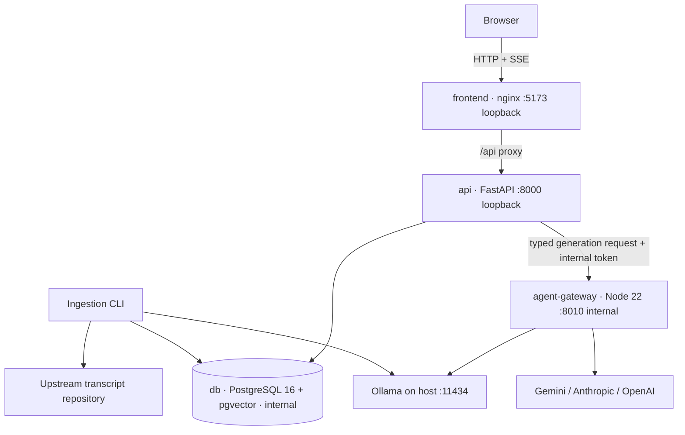
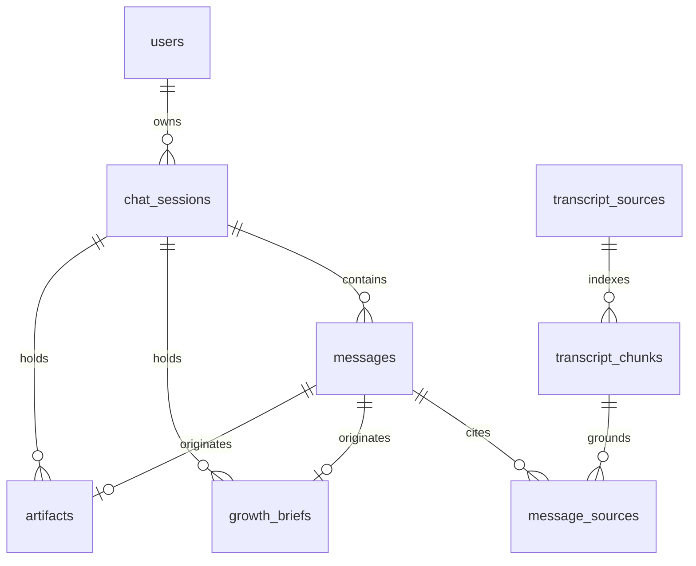
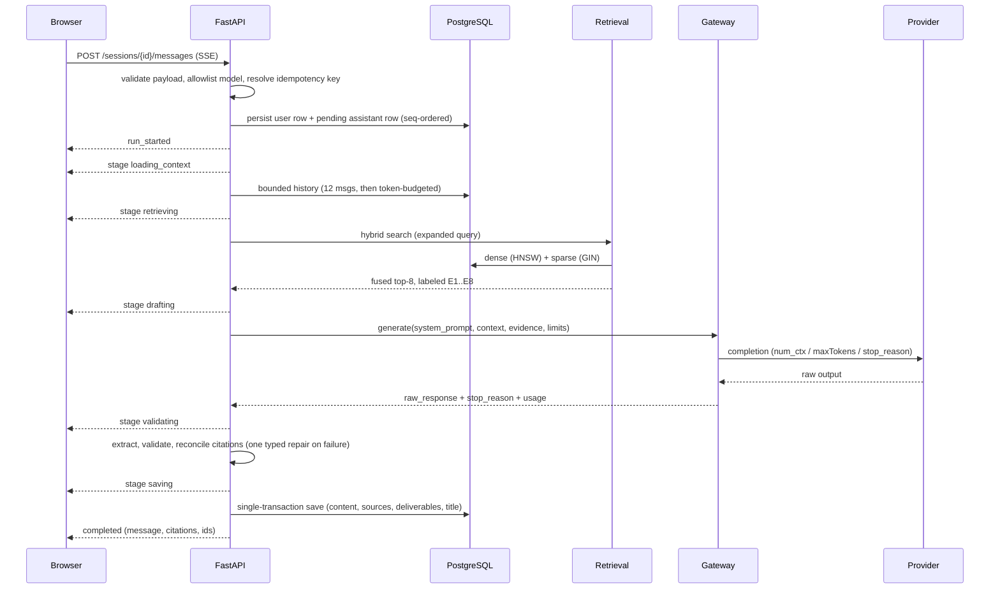
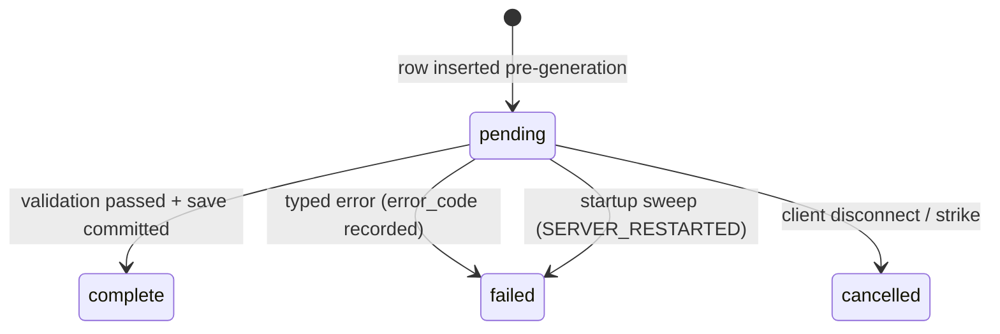
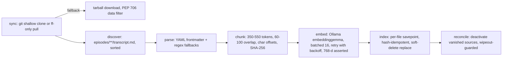
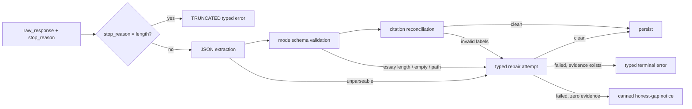

# System Architecture — The Lenny Growth Assistant (Codename: Kestrel)

| | |
|---|---|
| Version | 3.0 |
| Date | 2026-10-12 |
| Repository state | commit `223e0e4` |
| Audience | The client engineer who will run, troubleshoot, and extend this system |
| Companion documents | `PRD.md` (requirements and rationale) · `design.md` (UI system) · `manual-test-plan.md` (human verification) · `../IMPLEMENTATION_SPEC.md` (canonical build specification) |

This document describes the system as built. Where a behavior was verified live, the verification source is named. Where a claim is a target rather than a measurement, it is labeled as such.

---

## 1. Topology and system boundaries

Four services plus one host dependency. Only the frontend and API publish ports, and only to loopback.



| Service | Image/build | Responsibility | Exposure |
|---|---|---|---|
| `frontend` | Vite build served by nginx-alpine | Dossier UI; SPA routing; `no-store` on `index.html` | `127.0.0.1:5173` |
| `api` | `python:3.13-slim` | Identity, persistence, retrieval, prompt assembly, validation, provider policy, SSE | `127.0.0.1:8000` |
| `agent-gateway` | `node:22-bookworm-slim` (compiled, `node dist/server.js`) | Provider translation via `@earendil-works/pi-ai`; model/catalog validation; context and output limits | internal only (dev override: `127.0.0.1:8010`) |
| `db` | `pgvector/pgvector:pg16` | All persistence, vector and full-text indexes | internal only (dev override: `localhost:5433`) |
| Ollama | host process | Local chat (`qwen2.5:1.5b` default) and embeddings (`embeddinggemma`, 768-d) | host `:11434`; reached from containers via `host.docker.internal` (`extra_hosts: host-gateway`) |

`compose.dev.yml` publishes the debug ports; the base topology does not. Volumes: `postgres_data` (database — survives rebuilds and reboots), `./runtime-skills` (read-only mount), `./alembic.ini` (read-only mount). The transcript working copy is mirrored to `transcripts-cache/` on disk (git-ignored) for offline re-indexing.

## 2. Component boundaries and ownership

One rule governs every boundary: **models compose answers; the backend owns facts.**

| Concern | Owner | Explicitly not |
|---|---|---|
| Identity, session ownership | API (`get_current_user_id` stub + per-query ownership filters) | The browser, the model |
| Retrieval decisions | API retrieval service (deterministic) | The model — no agent-invoked search exists (ADR-001 amendment) |
| Evidence labels `E1…En` | API (assigned per run from fused rank; mapped to chunk IDs server-side) | The model may cite labels but cannot mint them |
| Prompt assembly | API `agent_client/prompts.py` + skill loader | The gateway does not author prompts |
| Provider translation, catalog validation, context/output limits | Gateway | The API does not speak provider APIs |
| Output structure and citation validity | API validator | Neither model nor gateway |
| Sanitization and isolation of artifacts | API (nh3 + CSP at save) and frontend (sandboxed frames at render) | The model's own restraint |
| Persistence and lifecycle | API services; single-transaction save stage | — |

The gateway is deliberately thin. It holds no product logic; everything it knows (allowlists, limits, schemas) is either configuration or duplicated validation of decisions the API already made.

## 3. Data model (current at migration 0006)



### 3.1 Tables

| Table | Key columns | Constraints and indexes |
|---|---|---|
| `users` | `id`, `display_name`, `email`, `metadata` JSONB | demo identity; email unique nullable |
| `chat_sessions` | `id`, `user_id`, `title`, `provider_preference`, `last_message_at` | ownership FK `ON DELETE CASCADE`; index on `user_id` |
| `messages` | `id`, `session_id`, `role`, `content`, `workflow_mode`, `provider`, `model_id`, `status`, `error_code`, `idempotency_key`, `seq`, `metadata` JSONB, `created_at`, `completed_at` | `status` CHECK; monotonic `seq` (ordering authority); partial unique `(session_id, idempotency_key) WHERE idempotency_key IS NOT NULL`; indexes on `session_id`, `created_at` |
| `message_sources` | `message_id`, `chunk_id`, `evidence_id`, `supports`, `retrieval_rank` | FKs cascade (message) / restrict-by-soft-delete (chunk — chunks are deactivated, never deleted, so provenance survives re-ingestion); reads ordered by `retrieval_rank` |
| `transcript_sources` | `source_key`, `title`, `guest`, `episode_url`, `video_id`, `publish_date`, `content_hash`, `repo_commit`, `is_active` | unique `source_key`; `content_hash` = SHA-256 of normalized content |
| `transcript_chunks` | `source_id`, `chunk_index`, `content`, `token_count`, `embedding vector(768)`, `content_hash`, `char_start`, `char_end`, `search_vector` (stored generated tsvector), `is_active` | HNSW on `embedding vector_cosine_ops`; GIN on `search_vector`; partial unique `(source_id, chunk_index) WHERE is_active`; partial index `(source_id) WHERE is_active` |
| `growth_briefs` | `session_id`, `source_message_id`, `title`, `version`, `status`, `product_context`, `data` JSONB | ORM `version_id_col` optimistic locking; `status` CHECK (draft/ready/archived); `source_message_id` FK `SET NULL` |
| `artifacts` | `session_id`, `source_message_id`, `growth_brief_id`, `kind`, `title`, `content`, `preview_content`, `version` | optimistic locking; `kind` CHECK (markdown/html); `preview_content` derived server-side at save |

CHECK constraints are declared both in migrations and in ORM metadata, so test databases built from metadata carry the same guarantees as production.

### 3.2 Migration history

| Revision | Purpose |
|---|---|
| 0001 | Initial schema (users, sessions, messages, sources, chunks, message_sources, briefs, artifacts) |
| 0002 | Users table formalization |
| 0003 | Spec alignment: lifecycle columns, char offsets, stored `search_vector` + GIN, CHECK constraints |
| 0004 | Deliverable constraints: pre-validated data cleanup, then CHECKs on brief `status` and artifact `kind` |
| 0005 | Chunk soft-delete (`is_active` + partial indexes) replacing destructive re-index; HNSW vector index |
| 0006 | Modernization: monotonic `seq`, `idempotency_key` + partial unique index; legacy duplicate columns dropped (`messages.mode`, `chat_sessions.provider`, `users.full_name`) |

Migrations are hand-written, run by the API container at boot (`alembic upgrade head` before uvicorn), and covered by a readiness check that fails when `alembic_version` is absent.

## 4. Request lifecycle (message turn)



Throughout the stream, `: ping` comment lines are emitted every 15 seconds so proxies with idle timeouts do not drop long generations. Client disconnect is detected (0.3s poll around the gateway call and via generator exit); the pending row is closed as `cancelled` and nothing partial is persisted.

### 4.1 Idempotency

`POST …/messages` accepts `Idempotency-Key` (or `X-Idempotency-Key`). The key is stored on the user message row under a partial unique index per session. A replayed key returns the stored completed turn verbatim; if the original is still in flight, the API returns the retryable code `REQUEST_IN_PROGRESS` rather than starting a duplicate run.

### 4.2 Message state machine



The startup sweep (`reconcile_stale_pending_messages`, run in the lifespan hook) closes rows stranded by a crash, so a restart can never leave a ghost "composing" state in the UI.

### 4.3 Error taxonomy

One envelope everywhere: `{ "error": { code, message, retryable, request_id } }`. Raw exception text never crosses the API boundary; full detail is logged server-side under the same `request_id`.

| Code | HTTP | Retryable | Trigger |
|---|---|---|---|
| `VALIDATION_ERROR` | 422 | no | Pydantic rejection (bounds, enums, control chars, whitespace-only content, mode/field combinations) |
| `NOT_FOUND` | 404 | no | Unknown or non-owned resource |
| `MODEL_NOT_ALLOWED` | 422 | no | Requested model outside the server-side allowlist / not installed in Ollama / not in gateway catalog |
| `PROVIDER_MISCONFIGURED` | 502 | no | Cloud key absent at the gateway (`missing_api_key`) or provider unsupported |
| `AUTHENTICATION_FAILED` | 502 | no | Internal service token rejected by the gateway |
| `PAYLOAD_TOO_LARGE` | 502 | no | Generation payload over the gateway body limit |
| `AGENT_UNAVAILABLE` | 502 | yes | Gateway unreachable |
| `GENERATION_TIMEOUT` | 504 | yes | Provider exceeded `GENERATION_TIMEOUT_SECONDS` (120) |
| `GENERATION_TRUNCATED` | 422 | no | Stop reason `length` survived the concision repair |
| `ESSAY_LENGTH_OUT_OF_RANGE` | 422 | yes | Essay gate failed after one repair |
| `MODEL_OUTPUT_INVALID` | 422 | yes | Extraction/schema/citation validation failed after one repair |
| `REQUEST_IN_PROGRESS` | (SSE) | yes | Idempotent replay while the original run is live |
| `GENERATION_FAILED` | 500 | yes | Classified fallback (gateway 5xx, unexpected) |
| `CANCELLED` | (stored status) | — | Run struck or connection lost |
| `SERVER_RESTARTED` | (stored `error_code`) | — | Pending row swept at boot |

Gateway-internal codes (`invalid_request`, `model_not_allowed`, `provider_not_supported`, `missing_api_key`, `model_not_found`, `provider_error`, `internal_error`, `internal_token_not_configured`, `forbidden`) are mapped by the gateway client into the typed exceptions above; a gateway `provider_error` (502, raised when pi-ai reports `stopReason: "error"`, with the nested provider message unwrapped) surfaces as a classified generation failure with the provider's own explanation logged server-side.

## 5. Ingestion pipeline



Properties that matter operationally:

- **Idempotency.** A source whose SHA-256 content hash is unchanged skips parsing, embedding, and writes entirely. `make ingest` is safe to run repeatedly.
- **Durable provenance.** A changed episode's old chunks are set `is_active = FALSE`, not deleted. Historical citations resolve to the exact text they supported forever; retrieval only reads active chunks.
- **Isolation.** Each file indexes inside its own savepoint; a failure rolls back that file, increments the error count, and the run continues.
- **Wipeout guard.** If discovery yields zero files (empty mount, bad path), reconciliation is skipped rather than deactivating the corpus.
- **Dimension assertion.** The embedding model is verified at API bootstrap (lifespan) and every batch asserts 768 dimensions; a model swap fails loudly instead of poisoning the index. Switching embedding models requires `make reindex`.
- **Provenance fields.** `repo_commit` (git SHA, or `archive-main` for the tarball path) and `upstream_path` are stored per source.

Commands: `make ingest` (sync + index) · `make ingest-check` (stats) · `make reindex` (forced) · `GET /api/v1/ingestion/status`.

## 6. Retrieval and grounding

### 6.1 Hybrid retrieval

Per turn (unless the query matches the conversational pre-router, §7.4):

1. **Query shaping.** Short (<6 words) or anaphoric queries are expanded with the previous user message and the first line of the previous assistant answer (citation markers stripped). Deterministic; no model call.
2. **Dense.** pgvector cosine over the HNSW index, `WHERE is_active` on both chunk and source, cutoff `RETRIEVAL_MIN_SCORE` (0.25), candidate pool `3 × top_k`.
3. **Sparse.** Stored `search_vector` against `websearch_to_tsquery('english', …)`, `ts_rank_cd` ordering, GIN-indexed, parameterized. Sparse failure degrades to dense-only with a logged warning.
4. **Fusion.** Weighted reciprocal rank fusion, `score = 0.6/(60 + rank_dense) + 0.4/(60 + rank_sparse)` (Cormack k=60). Fusion is a pure, unit-tested function.
5. **Selection.** Descending fused score; at most 3 chunks per episode; char-range overlap suppression drops near-duplicate windows of the same passage; first `top_k` (8) selected.
6. **Labeling.** `E1…En` assigned in selection order — the label number *is* the retrieval rank, which is the single numbering authority from database to UI.
7. **Sufficiency.** `insufficient_evidence` when nothing qualifies; a `weak_evidence` advisory flag when the best dense score falls under `RETRIEVAL_WEAK_DENSE` (0.32). Neither flag blocks generation (§7.3); both are recorded.

### 6.2 Evaluation

`docs/evaluation/retrieval_cases.yaml`: 20 curated cases across factual, semantic, framework, multi-episode, follow-up, unsupported, nuanced, and typo classes, with expected source keys. `make benchmark` runs them against the live corpus (Recall@5 + unsupported-detection accuracy); `make benchmark-ci` uses the deterministic fake embedder against a fake-embedded index for dependency-free CI. Spec target: Recall@5 ≥ 80% — a gate to run, not a claimed result.

## 7. Agent layer

### 7.1 Prompt assembly

The system prompt is composed per turn, in this order:

1. **Base instructions** — identity (conversational growth-research companion), the epistemic rules (archive facts cited `[E#]`; own reasoning welcome but labeled and never attributed to the archive; user product context fenced; transcripts and history declared untrusted data; conversational turns citation-free; out-of-scope handling; answer proportionality), a capability card for self-description, and the JSON output rule.
2. **Mode instructions and output schema** — one per workflow mode.
3. **Runtime skill text** — `ship-30-for-30` for essays; `document-craft` for artifacts (parsed into sections so essays receive the bans and Markdown rules, artifacts receive the full craft charter including the mermaid policy). Skills are versioned frontmatter files; name and version are stamped into message metadata.
4. **User-supplied product context** — labeled as framing material, never evidence.
5. **Evidence block** — the run's labeled passages (or an explicit "no relevant evidence found" line).
6. **Output reminder** — appended to the system prompt tail (not to the user turn, so replayed history matches what the model saw).

The current user message travels as its own turn; prior turns are replayed from stored content with citation markers stripped (labels are request-scoped; replaying stale `E1`s would create contradictory referents).

### 7.2 Gateway contract

`POST /api/v1/generate`, authenticated with `x-internal-service-token` (fail-closed: unconfigured token returns 503; comparison is timing-safe). Request (zod-validated): `request_id`, `session_id`, `mode` (5-enum), `provider` (`local|cloud`), `cloud_provider`, `model_id`, bounded `conversation_context` (role/content plus per-turn `provider`/`model_id` for faithful history attribution), `current_user_message` (min length 1), `evidence[]`, **required** `system_prompt`, `product_context`, `output_contract_version`.

Model resolution: local requests must equal the configured `OLLAMA_CHAT_MODEL`; cloud requests must match an ID in the pi-ai catalog for that provider exactly — no substitution, ever. Response: `raw_response`, `stop_reason`, `usage`, `latency_ms`, echoed identifiers.

Provider limits (gateway-enforced, per request):

| Provider | Context | Output cap |
|---|---|---|
| Ollama | `num_ctx` 16384 (`OLLAMA_NUM_CTX`) via request options | `num_predict` 3072 (`OLLAMA_MAX_OUTPUT`) |
| Gemini | catalog context window | 8192 |
| Anthropic | catalog context window | 8192 |
| OpenAI | catalog context window | 4096 |

Note on the Ollama mechanism: the `num_ctx` value travels in the OpenAI-compatible request body's `options` field. Official Ollama documentation does not list this parameter for `/v1`; it works on the verified host build (Ollama 0.40.2, transcript 015/016) and `OLLAMA_CONTEXT_LENGTH` on the host is documented as the guaranteed fallback. Backend history budgeting keeps prompts inside the allocation regardless: 12-message hard cap, then token trim (≈4 chars/token) to `HISTORY_TOKEN_BUDGET_LOCAL` (4,000) or `_CLOUD` (20,000), whole messages only, newest kept.

### 7.3 Validation and repair



- **Extraction.** `json_extractor` handles documented small-model deviations: `<think>` blocks, code fences (greedy and non-greedy), prose preambles/postambles, balanced-brace recovery. Its existence is an empirical response to `qwen2.5:1.5b` behavior (transcript 001), not speculation.
- **Reconciliation.** Inline `[E#]` labels are matched against the run's evidence map: invalid labels are stripped from text; valid labels missing from the model's citations array are auto-added (supports string empty, rank preserved). The invariant after this stage: every marker in persisted text resolves to a note, and numbering is identical everywhere.
- **Typed repair.** At most one retry. The repair prompt states the actual failure reason — `JSON_PARSE`, `ESSAY_LENGTH`, `EMPTY_ANSWER`, `INVALID_LABELS`, `INVALID_WRITING_PATH`, `ARTIFACT_STYLE`, `TRUNCATED` — with reason-specific instructions (e.g., length failures get "add or cut real content, never pad"; truncation gets concision guidance).
- **Conversational prose fallback.** For retrieval-skipped conversational turns only, a non-JSON raw response is accepted as the answer text with empty citations. This is the single place raw model prose is persisted, and it is reachable only for end-anchored pleasantry/identity patterns.
- **Structured outputs status.** Grammar-constrained decoding via forced tool calls was evaluated and rejected for the local path: Ollama ignores `tool_choice` enforcement on small models and the attempt degrades inference (transcript 016, probe 5). Cloud-native structured outputs remain a roadmap item; the extractor is the floor.

### 7.4 Conversational pre-router

A turn in `research` mode whose content fully matches an end-anchored pleasantry/identity pattern (`hi`, `hello`, `thanks`, `who are you`, `what can you do`, acknowledgments, farewells — the entire string must match, so "hey what about pricing?" does not) skips retrieval and generates against an empty evidence block. This keeps greetings warm and instant without spending a search, and keeps substantive queries on the grounded path.

### 7.5 Save stage

One transaction: assistant content and status, `message_sources` rows (evidence label, supports text, retrieval rank), deliverable rows (brief or artifact, created through their services without intermediate commits), provenance metadata (`evidence_rrf_scores`, skill stamp), session title derivation, `last_message_at`. A failure anywhere rolls back everything — no orphaned deliverables, no half-bound turns.

## 8. Artifact pipeline

1. **Generation.** Mode `artifact_markdown` or `artifact_html`; the document-craft charter governs style (editorial print aesthetic; explicit bans: emoji, gradients, glassmorphism, glow, generic hero layouts, AI-recap voice). HTML must be a complete standalone document with local CSS only.
2. **Validation.** Non-empty title and content; evidence-ID filtering against the run map; emoji lint (`ARTIFACT_STYLE` repair reason).
3. **Sanitization (HTML, server-side at save).** nh3 with a 68-tag allowlist; attribute allowlists per tag; URL schemes `http(s)/mailto/data/blob`; forced `rel="noopener noreferrer"`; `<style>` blocks extracted and cleaned (`@import`, external `url()`, `expression()`, `behavior:` removed); the sanitized body is wrapped in a preview document carrying a `default-src 'none'` CSP meta. `preview_content` is derived at save; the original `content` is retained for the Source view and download.
4. **Rendering (client).** Previews display in `<iframe sandbox="">` — no scripts, no same-origin, no forms, no popups, no top navigation. Markdown renders through a custom parser that emits React elements only (GFM tables, rules, h1–h6; raw HTML escaped by construction; images not rendered, by policy).
5. **Mermaid.** Fences in Markdown render via pinned `mermaid@11.17.2` at `securityLevel: 'strict'`; in-band `%%{init}%%` directives are stripped before render; the produced SVG is displayed inside a `sandbox="allow-scripts"` frame with an opaque origin and its own CSP — diagram markup never enters the parent DOM. Render failures fall back to the preserved source with an error stamp.

The trust rule end to end: model-authored markup is inert data until the sanitizer and the sandbox have both acted on it.

## 9. Skills

| Skill | Applies to | Contract |
|---|---|---|
| `ship-30-for-30` (v1, `min_model_tier: mid`) | Essay mode | Hook craft and headline patterns; 4A writing paths (validated enum); outline-first structure; rate-of-revelation pacing; skimmable formatting; grounded-claims rules mirroring the citation pipeline; word bounds enforced by the validator, not the prompt |
| `document-craft` (v1) | Artifact modes (full), essay mode (bans + Markdown rules) | Editorial typography and layout rules; table and figure conventions; mermaid usage policy (one flowchart maximum, short quoted labels, no style directives, never in HTML artifacts); the ban list; pre-return checklist |

The loader parses versioned frontmatter, degrades to a one-line fallback if a file is missing or malformed, and never crashes a run. Skill name and version are stamped into message metadata for traceability. Runtime skills are product assets (`runtime-skills/`), deliberately separate from the repository's coding-agent rules (`.agents/`).

## 10. Security model

### 10.1 Trust boundaries

| Boundary | Untrusted input | Controls |
|---|---|---|
| Browser → API | All request bodies, headers, path params | Pydantic bounds and enums; control-character rejection; whitespace rejection; ownership filters on every query; idempotency index |
| Transcript corpus → prompts | Quoted evidence text | Declared untrusted in the system prompt; physically delimited in the evidence block; model instructed to ignore embedded directives |
| Model → backend | Raw generation output | Extraction, schema validation, citation reconciliation, style lint, bounded single repair, typed terminal errors |
| Model → browser (artifacts) | Generated HTML/Markdown/mermaid | §8 pipeline: allowlist sanitization, CSP, sandboxed frames, escape-only Markdown rendering |
| Backend → gateway | Internal service call | Shared token (fail-closed, timing-safe); gateway not host-published; zod schema; catalog-exact model matching |
| Gateway → providers | Provider responses | Stop-reason propagation; provider-error unwrapping; timeouts; no secrets in logs |

### 10.2 Standing invariants

- Secrets exist only in `.env` and server memory. The browser sends provider enums and allowlisted model IDs. Bootstrap scripts refuse the published placeholder token and generate a fresh one.
- Logs carry counts, IDs, statuses, and durations — never prompt bodies, transcript passages, keys, or raw provider errors. Redaction is enforced at the envelope layer, not by convention.
- SQL is parameterized everywhere, including the full-text query construction.
- Archive extraction uses the PEP 706 `data` filter.
- Artifact previews are sanitized server-side before the browser ever sees them; the client sandbox is defense in depth, not the first line.
- Sessions are identified by UUID but authorized by ownership filter — an ID is not a credential.

### 10.3 Known limitation

Authentication is a single-user demo stub by design (PRD §2.3). Every query already filters by `user_id`; introducing real identity does not change the data layer.

## 11. Configuration and deployment

Configuration resolution: process environment overrides `.env` overrides validated defaults in `backend/app/core/config.py`. Docker Compose passes model variables through with empty defaults so `config.py` is the single source of truth; `INTERNAL_SERVICE_TOKEN` is compose-required (`${VAR:?}`) — the stack refuses to start without it. `OLLAMA_CHAT_MODEL` is read by both the API (allowlist) and the gateway (exact-match check); keep one value.

Startup paths:

- **One command.** `./start.sh` (bash) or `start.bat`/`.\start.ps1` (Windows): Docker engine check → Ollama reachability + model pulls → `.env` creation with generated token → `docker compose up -d` → database health wait → `alembic upgrade head` → API readiness poll → knowledge-base check with automatic sync/index when empty → success banner → browser launch. `NO_BROWSER=1` / `-NoBrowser` suppress the last step.
- **Manual.** `make demo` then `make ingest` (README quickstart).
- **Development without Docker.** `make dev-expose` for db+gateway with debug ports; uvicorn from the repository root; Vite dev server. The Makefile is the command contract; names match spec §7.2.

Deployment notes: the API container runs migrations before serving; `restart: unless-stopped` on all services; the database lives in a named volume that survives rebuilds; the frontend nginx sends `no-store` for `index.html` so deploys are immediately visible.

## 12. Observability

- **Structured logs.** `JsonLogFormatter` emits one JSON object per record (timestamp, level, logger, message, standard fields); non-string payloads are serialized defensively. Request/correlation IDs are minted or accepted at the edge middleware, returned in response headers (`x-request-id`, `x-correlation-id`, `x-response-time-ms`), propagated to the gateway (`x-request-id`), and present in gateway log lines.
- **Logging policy.** Counts, IDs, provider/model, durations, statuses, redacted error categories. Never prompt bodies, transcript text, artifact content, or secrets. Full exception detail goes to server logs only.
- **Run telemetry.** Stage events double as user-facing progress; message metadata stores `evidence_rrf_scores`, skill stamps, and repair/label counters; `stop_reason` and gateway latency/usage are captured at the client boundary.
- **Health.** `/api/v1/health/live` (process only). `/api/v1/health/ready` (database connectivity *and* migration state; Ollama and gateway reported per-component without blocking readiness). `GET /api/v1/providers` reports live availability with short timeouts and redacted errors.
- **Diagnosis paths.** A failing run: take `request_id` from the response header or SSE error, grep both services' logs. A retrieval surprise: `evidence_rrf_scores` in message metadata plus `GET /api/v1/chunks/{id}` for the exact passage. An artifact rendering question: compare `content` (original) with `preview_content` (sanitized derivation) via the artifact API.

## 13. Resilience

| Failure | Behavior |
|---|---|
| Missing cloud key | `PROVIDER_MISCONFIGURED` before any work starts; no silent provider switch |
| Ollama down / model missing | Health and provider endpoints report it; generation fails fast with typed, actionable errors; bootstrap scripts check before the stack starts |
| Generation timeout | 120s ceiling; run closed as failed with `GENERATION_TIMEOUT`; retryable |
| Provider mid-completion error | pi-ai stop reason `error` → gateway 502 `provider_error` with the unwrapped provider message (logged, redacted at the boundary) |
| Truncated output | Stop reason `length` → `TRUNCATED` typed repair (concision guidance) → terminal `GENERATION_TRUNCATED` (non-retryable: same limits would repeat it) |
| Corrupt model output | One typed repair with the true reason; then terminal error, or the canned honest-gap notice when evidence was empty |
| Empty retrieval | Generation still runs; honest-gap answer shape; canned notice only as validation-failure fallback |
| API crash mid-run | Startup sweep marks stranded pendings `failed`/`SERVER_RESTARTED` |
| Client disconnect / strike | Stream closed; row `cancelled`; nothing persisted; composer offers recompose with the original text |
| Duplicate submission | Idempotency key replay returns the stored turn or `REQUEST_IN_PROGRESS` |
| Database failure | Fail closed: nothing claims success that could not be saved |
| Gateway body limit | `PAYLOAD_TOO_LARGE`, non-retryable; history budgeting keeps normal turns far below it |
| Re-ingestion of a cited episode | Old chunks soft-deactivated; historical citations keep resolving |

## 14. Testing and verification architecture

| Layer | Suite | Proves |
|---|---|---|
| Backend units | `pytest tests/unit -m "not integration"` — 176 tests | Validator gates and repair reasons, citation reconciliation, extractor adversarial cases, retrieval fusion and dedupe, ingestion idempotency and guards, API contracts and envelopes, SSE heartbeat, idempotency and sweep (Wave B/C regressions), gateway client mapping |
| Evaluation | `pytest tests/evaluation` — 3 tests | Fixture integrity (20 cases, required classes) and benchmark runner correctness |
| Frontend | `vitest run` — 102 tests across 11 files | Citation segmentation and numbering, motion interruption/reversal and reduced-motion, mermaid security, focus traps, Markdown rendering, artifacts dock disclosure and collision, leader-line geometry, signature moments, API client |
| Security payloads | `tests/unit/security/` | Sanitizer against `<script>`, `onerror`, `javascript:`, external CSS/images, forms, iframes, meta refresh |
| Integration (opt-in) | `tests/integration/` | Live Ollama, live gateway, database/readiness, frontend proxy — run against the real stack, not mocks |
| Static quality | `make lint` (ruff check + format), `make typecheck` (mypy + tsc/build), gateway `tsc --noEmit` | Style, types, compile |

Live-verification status (honest ledger, per transcript 016 and `002`): **Ollama (qwen2.5:1.5b, embeddinggemma) and Gemini (gemini-3.5-flash-lite) verified end-to-end on the container stack.** Anthropic and OpenAI routing is implemented, catalog-validated (`claude-sonnet-5` and `gpt-4o` confirmed present in the installed pi-ai catalog data), and type-checked, but has not been exercised live for want of evaluator keys. `agent-transcripts/` holds the command-level evidence for every phase, including failed attempts.

## 15. Extension points

| Change | Seam | Notes |
|---|---|---|
| New workflow mode | `mode` enums (API schema, gateway zod), `prompts.py` (schema + instructions), `validator.py` (branch), composer UI | `output_contract_version` exists to coordinate contract changes |
| New runtime skill | Drop `runtime-skills/<name>/SKILL.md` with versioned frontmatter; load via the skill loader in the relevant mode | No code change required for injection into an existing mode's prompt |
| New cloud provider | pi-ai provider registration in the gateway + `CLOUD_PROVIDER_META` + config allowlist entry | The per-request `apiKey` option in pi-ai makes in-app credential management additive (designed, deferred) |
| Retrieval signal (e.g., reranker) | Fusion inputs in `HybridRetrievalService.search`; keep fusion pure and unit-tested | Calibrate against the benchmark fixture before shipping |
| Real authentication | Replace `get_current_user_id`; ownership filters already parameterized by `user_id` | `provider_keys`-style per-user resources follow the same pattern |
| Token streaming | Gateway `models.stream` + SSE token events; validation moves to completion-time | Cancellation plumbing already exists |

## 16. Repository map

```text
backend/app/
  api/v1/          routers (sessions, messages+SSE, briefs, artifacts, sources, providers, config, health)
  services/        conversation orchestration, sessions, briefs, artifacts
  agent_client/    gateway client, prompt builders, skill loader, validator, json extractor
  retrieval/       hybrid search, embedder, benchmark runner
  ingestion/       syncer, parser, chunker, indexer, CLI
  security/        nh3 sanitizer + CSP preview builder
  core/ models/ db/ main.py   config, ORM entities, engine, app wiring (middleware, JSON logs, lifespan)
  migrations/      0001 … 0006
agent-gateway/src/ server.ts (providers, limits, auth, generate, health) · spike.ts (Phase-0 evidence)
frontend/src/      components/ lib/ styles/ test/ · public/fonts
runtime-skills/    ship-30-for-30 · document-craft
tests/             unit · integration · evaluation
docs/              this document · PRD · design · manual test plan · frontend integration spec
                   · ADRs · evaluation fixture · audits/ (audit cycle + verification index)
                   · proposals/ (deferred designs)
agent-transcripts/ phase evidence logs
uiux-research/     design research and prototypes
start.sh start.ps1 start.bat   one-command bootstrap (see §11)
Makefile docker-compose.yml compose.dev.yml alembic.ini .env.example pytest.ini ruff.toml
AGENTS.md IMPLEMENTATION_SPEC.md START_HERE.md .agents/
```

Runtime artifacts (not committed): `transcripts-cache/` (mirrored upstream transcripts) and `.env`.
