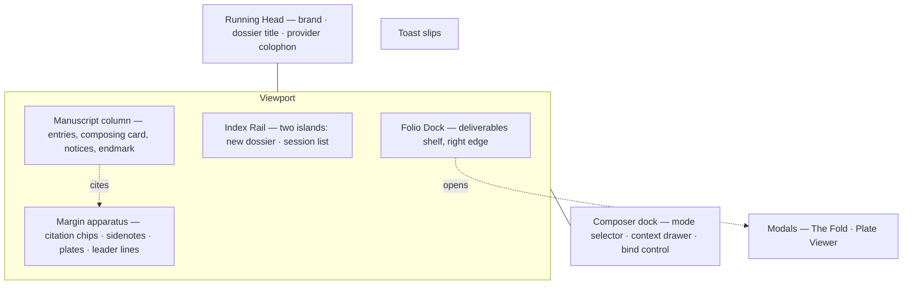

# Design System and UI Specification — The Editorial Research Studio

| | |
|---|---|
| Version | 3.0 ("Studio Dossier") |
| Date | 2026-10-12 |
| Repository state | commit `223e0e4` |
| Applies to | `frontend/src/styles/dossier.css`, all files under `frontend/src/components/`, `frontend/src/lib/` |
| Companion documents | `PRD.md` (product requirements) · `architecture.md` (system design) · `manual-test-plan.md` (verification) · `../uiux-research/awwwards-bone-aubergine-design-research.md` (founding design research) |

This document describes the design system as shipped. Where the implementation deliberately departs from the founding research, the decision and its reason are recorded in §9. Nothing here describes planned work as completed.

---

## 1. Design thesis

Kestrel is a **bound research dossier**, not a chat application. The page is bone paper; the mechanism is plum ink; the reader's work product is filed, stamped, and citable. Every surface answers the question "what is this made of?" before it receives color, shadow, or motion:

- The **manuscript column** is the page: prose set in a measured column with a right-hand margin for apparatus.
- **Citations** are beads of ink in the text, tied by leader lines to notes in the margin.
- **Deliverables** are physical objects: a brief is a folded folio, an artifact is a plate examined in a sandboxed frame.
- **Sessions** are dossiers indexed in a left-hand rail of two sharp floating islands.
- **Feedback** arrives as printed slips (toasts) and letterpress stamps, in a voice that never oversells.

Three consequences follow, and they govern disputes:

1. **Asymmetry is the layout's opinion.** A column with a margin, not a centered stack. Nothing is horizontally centered except the composer dock and the running-head title.
2. **The resting page is still.** Motion is a response to a cause — a gesture, a state change, an arrival. The only idle animations in the product are the composing-state pulse and the provider dot's breath, both gated to an active run.
3. **Security is part of the aesthetic.** Plates are "examined, never trusted," and the UI says so. The sandbox stamp is a design element, not an apology.

## 2. Design tokens

All values below are the shipped values in `dossier.css :root`. One source of truth; components never hard-code raw values where a token exists.

### 2.1 Color — bone paper, plum ink

| Token | Value | Role |
|---|---|---|
| `--canvas` | `#F2F0E9` | Page background — warm bone, never gray, never white |
| `--surface` | `#FAF8F2` | Raised paper: cards, panels, popover, slips |
| `--ink` | `#161614` | Primary typography — warm near-black |
| `--ink-soft` | `#3D3A37` | Body copy in quotes, secondary prose |
| `--muted-ink` | `#6B6663` | Metadata, labels, stamps (4.7:1 on canvas) |
| `--faint` | `#716A64` | Subtle captions and hints (4.69:1 on canvas — the weakest permitted text pair) |
| `--border` | `#DDD7CB` | Hairlines, rules, card edges |
| `--accent` | `#4A1F3D` | The mechanism: beads, active states, links, focus rings, leader emphasis |
| `--accent-ink` | `#3A1729` | Accented text, hovered links |
| `--accent-soft` | `#E8DEE3` | Pale plum wash: badges, chips, pills |
| `--accent-line` | `#A07B8E` | Dividers, leader lines at rest |
| `--wash` | `rgba(74,31,61,.08)` | Hover washes, paragraph highlight behind a hot citation |
| `--success` | `#3D5A4A` | Verified states — always paired with a tick glyph and a word |
| `--danger` | `#8B2D1F` | Errors, strike, destructive actions (`--crimson` is an alias) |
| `--gold` / `--gold-soft` | `#A98A54` / 14% wash | Foil ornament, exactly three uses: the endmark diamond, the plate impression chip, and the folio accent. A fourth use is a defect |

Shadows are paper, not CSS: `--shadow-page` (resting sheet), `--shadow-raised` (hover/lift), `--shadow-modal` (overlays), each a tight contact layer plus a soft ambient layer. Elevation tier and shadow tier map 1:1; no component invents its own shadow. A fixed film-grain overlay (SVG turbulence, opacity 0.025, multiply blend) gives the whole page tooth.

### 2.2 Typography — the Studio Dossier stack

| Role | Stack | Loading |
|---|---|---|
| Brand | `Maghfirea` → Cabinet Grotesk → serif | Self-hosted OTF/TTF, `@font-face`, `font-display: swap` |
| Display / UI | `Cabinet Grotesk` → PP Mori → system-ui | Referenced in stack; when not installed on the host system it resolves to PP Mori (see note below) |
| Text | `PP Mori` → Cabinet Grotesk → system-ui | Self-hosted WOFF 400/600, `font-display: swap` |
| Data / stamps | `Spline Sans Mono` → ui-monospace | Google Fonts, variable 400–600, preconnected |

Note on licensing: the self-hosted display faces are retail typefaces embedded in the repository. Confirm redistribution rights for the deployment context before external distribution; OFL-licensed substitutes drop in via the same `@font-face` block if required (PRD risk R10).

Fluid scale (the complete allowed set — no component introduces a size outside it without a token):

```text
--t-display clamp(38px, 6.8vw, 80px)   frontmatter hero
--t-h1      clamp(28px, 4.2vw, 42px)   fold title, essay heads
--t-h2      clamp(20px, 2.5vw, 26px)   entry sections
--t-h3      17px                        query cards
--t-lead    clamp(17px, 1.85vw, 20px)   answer lead
--t-body    15.5px                      manuscript body
--t-meta    12px                        stamps, kickers
--t-micro   10.5px                      spine labels, badges
```

Editorial details in use: drop cap on answer leads (display face, accent color); oldstyle numerals on rail folio numbers (`onum`); tabular + oldstyle on stamps (`tnum`, `onum`); letterspaced small-caps kickers at 0.13–0.16em tracking; roman-numeral section markers in the left position; the `¶` pilcrow as the composer glyph and entry counter.

### 2.3 Geometry and elevation

```text
--col 616px        manuscript measure (560px below 1250px viewport)
--col-pad 44px     column-to-margin gutter
--note-w 312px     margin apparatus width (268px below 1250px)
--note-gap 16px
Radii: 0 for islands, rules, and sheets · 3px beads and small controls · 9px cards and slips · 12px popovers and modals · 999px only for true pills (buttons, chips, badges)
Z-index bands: page 1 · leaders 5 · rail 150 · head 200 · colophon 300 · dock 850 · rail-drawer 950 · composer 120 · fold 1200 · plate viewer 1300 · grain 2400 · toasts 2600
```

### 2.4 Motion tokens

```text
Durations   instant 80 · fast 160 · normal 240 · deliberate 400 · cinematic 640 (ms)
Curves      out-expo (0.16,1,0.3,1) · in-out-soft (0.65,0.05,0.36,1) · spring (0.34,1.56,0.64,1)
            sheet (0.32,0.72,0,1) · attention (0.2,0.9,0.1,1.2)
Springs     linear() baked curves — snappy, gentle, heavy — each with an @supports fallback
            to the cubic-bezier springs for browsers without linear() easing
```

Property law: only `transform`, `opacity`, `filter`, `clip-path`, and CSS custom-property-free paint-safe properties animate. The one accepted exception is the rail's width transition (§9, decision D7). `will-change` is never shipped statically; WAAPI animations are created just-in-time by the motion helpers.

## 3. Information architecture



| Region | Behavior |
|---|---|
| Running head | Fixed 54px. Brand left; dossier title centered (inline-rename with character counter and limit states); colophon chip right ("Set in {model} · {provider}") opening the provider popover. The provider dot breathes only while a run is composing |
| Index rail | Two sharp floating islands on the left: "new dossier" and the session list. 50px icon spine at rest, expanding to 280px on hover/focus/open with labels fading in. Active dossier marked by an accent left rule and soft fill; folio numerals in oldstyle. Delete reveals on hover/focus-within |
| Manuscript | The reading column: query cards, answer entries (lead + roman-numeral sections), the composing step-card, notices (insufficient, struck, failed), the endmark diamond with its "End of folio" stamp |
| Margin apparatus | Citation chips and expanded sidenotes, margin plates, and the leader-line SVG layer. Below 1120px the margin collapses into the flow (§7) |
| Folio Dock | Right-edge deliverables shelf (260px, `top: 70px`): bound brief + plates for the session. Progressive disclosure — absent entirely when the session holds no deliverables. Collision avoidance: glides to `top: 310px` while the colophon popover is open, returns on close. Collapsible to a tab |
| Composer dock | Fixed bottom sheet: mode radios (Query / Brief / Essay / Plate with Markdown-HTML sub-selection), product-context drawer, `¶` writing line, Bind control. Focus lifts the sheet's shadow and turns the pilcrow accent |
| Modals | The Fold (growth brief) and the Plate Viewer — both focus-trapped, Escape-closed, `aria-modal`, focus restored to the opener |
| Toasts | Printed slips above the composer, max three, tilted −0.35°, spring entrance, reverse exit, danger variant with oxblood rule and strike glyph |

## 4. The citation system (the signature grammar)

Bead, leader, and note behave as one object with three anchors.

- **Numbering.** One authority: the retrieval rank. `[E3]` in text = bead 3 = margin note 3 = `retrieval_rank` 3 in the database, stable across reloads. Unknown or stripped markers never render as dead text.
- **Beads (`.sn-ref`).** Inline superscript pills, accent-on-soft-plum at rest, inverting on hover/hot/focus. Visual size 1.1em with a 24px effective target via `::after { inset: -6px }` hit-slop.
- **Chips and notes.** Margin citations rest as one-line collapsed chips (number, speaker, episode). Clicking a bead — or the chip — expands the full note: quote (read from the stored chunk), episode link with `↗`, and the provenance stamp (`Rank #n · Fused 0.xxx`). `aria-expanded` tracks state.
- **Peek.** Hovering a bead shows the quote as a tooltip at the point of attention, so the common "check the source" gesture never scrolls.
- **Leader lines.** Hand-drawn beziers from bead to note with a terminal dot. At rest: dashed, 0.38 opacity — present but quiet. On hover/focus of either endpoint: the line, both endpoints, and the containing paragraph wash highlight together. On first appearance: a 640ms ink-draw. Geometry is percentage-based against the sheet, so scroll height never ratchets to historical maxima.
- **Click navigation.** Bead → note scrolls and flashes the note (attention curve with 1.025 overshoot); note → bead scrolls back.

## 5. Component states and signature motion

Every interactive component defines: rest, hover, focus-visible, active/pressed, busy, error, empty. The catalog of implemented signature motion:

| Moment | Trigger | Behavior |
|---|---|---|
| The Bind | Query submission | View Transitions lift the new entry into the manuscript where supported; everywhere else the capped entry-arrive stagger (40ms per entry) carries it |
| The Fold | Brief modal open/close | Opens as a paper fold: perspective on the scrim, card from `rotateX(10deg)` under a spring-heavy curve, shadow landing at modal tier. Closes on a 320ms reverse fold — interruptible, never a hard cut |
| The Strike | Cancelling a run | An accent rule draws through the composing card, the card desaturates, then the "Run struck — nothing was persisted" notice and slip arrive. Cancellation is communication |
| The Bloom | Answer completion | The endmark diamond blooms once (spring-snappy scale), gold foil. Completed answers only — never decorative idling |
| Stamp press | Primary actions | 0.97 scale on press; a 0.6s spring "settle" on success |
| Conflict shake | 409 on brief save | The impression chip shakes once (attention curve, three oscillations) — the only negative-emotion animation in the product, reserved for errors |
| Slip toasts | Any toast | Enter rising with −0.5° → −0.35° tilt on a gentle spring; exit reverses; the stack caps at three |
| Composing steps | Run in flight | Step marker pulses while running; completed steps show a success tick beside the word "verified"; detail text names the real pipeline stage |
| Plate origin | Opening a plate | The viewer frame FLIPs from the margin plate's rectangle — the plate leaves the margin and takes the stage |
| Provider dot | Colophon | Status dot breathes (2.2s sine) only during a composing run |

Reduced motion is a first-class mode: a global media query collapses animations and transitions to 0.01ms (retaining 150ms opacity fades for toasts and notes), and the JS motion helpers (`play`, `flip`, settle, stagger) short-circuit to instant final states. Smooth scrolling degrades to instant. Nothing in the product depends on motion to communicate state — every motion has a static equivalent (class, color, word).

## 6. Accessibility

- **Contrast.** All text pairs meet WCAG AA at their shipped sizes; the weakest pair (`--faint` on canvas) measures 4.69:1 and is documented in the token table. Body ink exceeds 15:1. Gold is ornament only, never text below 16px.
- **Color is never the only signal.** Verified = tick glyph + the word "verified." Danger = strike glyph + copy + oxblood. Provider status = dot + label text. Title-limit states = counter pill + weight + copy.
- **Keyboard.** Full traversal of rail, composer, entries, beads, chips, dock, and modals. Skip link on first Tab. Focus rings: 2px accent, 3px offset, visible on every interactive element. Modals trap focus and restore it on close. Enter submits; Shift+Enter breaks line; Escape strikes a run or closes a modal.
- **Screen reader.** `aria-live` status region announces every pipeline stage, provider change, strike, and save. Toasts carry `role="status"`. Citation chips expose `aria-expanded`; beads carry descriptive labels; the leader SVG is `aria-hidden` (decorative redundancy for a textual relationship).
- **Targets.** Beads 24px effective; composer controls full-height; the rail delete affordance is 18px inside a hover-revealed row — a documented compact-control exception (§9, D9).
- **Sandboxed content.** Plate previews are inert by construction: no scripts, no forms, no network, no same-origin. A screen reader encounters them as titled frames with the source available as text.

## 7. Responsive behavior

| Breakpoint | Changes |
|---|---|
| > 1250px | Full geometry: 616px column, 312px margin, leaders active, dock visible |
| ≤ 1250px | Column 560px, notes 268px, pilcrow entry counters hidden |
| ≤ 1120px | Leader lines off (nothing to draw); sidenotes and plates join the flow as full-width blocks; the Folio Dock hides — deliverables remain reachable from entries and the brief button |
| ≤ 899px | Rail becomes an off-canvas drawer behind the head menu button; composing steps collapse to two columns; the Fold goes full-height with a single-column section grid; composer padding tightens |

The margin-to-inline transformation is intentional: on a narrow page, margin notes become footnotes. This is what paper does.

## 8. Copy and voice

The product speaks like a letterpress shop, not a SaaS dashboard. Rules:

1. Verbs are physical and match the motion: **bind** (submit), **strike** (cancel), **cast** (generate an artifact), **examine** (open a plate), **compose** (generating).
2. Success copy states what was made and what was verified: "Growth brief bound — first impression", "3 citations verified".
3. Failure copy states what happened and what to do, without blame or cheer: "Could not delete dossier — the archive kept it", "Run struck — nothing was persisted".
4. Honesty copy is branded: "Not in the archive … I'd rather show you the gap than invent a figure."
5. Loading copy is true: stage labels map 1:1 to real backend phases ("consulting the archive", "verifying citations").
6. No exclamation marks. No "seamless", "powerful", "exciting". No emoji anywhere in product copy — the ban the document-craft skill enforces on model output applies to the house voice as well.
7. Any demo or fixture content announces itself ("design tour plate · not persisted"). The production bundle ships no fixtures.

Terminology glossary (used consistently across UI, docs, and code): dossier (session) · entry (a turn pair in the manuscript) · folio (the bound brief) · plate (artifact) · bead (inline citation) · sidenote/chip (margin citation) · leader (connecting curve) · bind (submit) · strike (cancel) · cast (generate artifact) · impression (saved version).

## 9. Decision log

| # | Decision | Rationale | Alternatives considered |
|---|---|---|---|
| D1 | Floating-island rail instead of a solid book-spine sidebar | Owner art direction (commit `013`/`03eee9f` lineage): sharper, lighter silhouette against bone; keeps the index-tab grammar (left rule, folio numerals) | The research document's aubergine spine — retained in `uiux-research/` as the founding study |
| D2 | Studio Dossier typography (Maghfirea / Cabinet Grotesk / PP Mori) replacing the Fraunces/Newsreader research stack | Owner art direction; self-hosted with `font-display: swap` | Variable-axis Fraunces mechanics (SOFT/WONK) were part of the research system; static faces trade axis play for a distinct editorial silhouette. Redistribution rights must be confirmed before external deployment (PRD R10) |
| D3 | Light-only ("bone folio") | Paper metaphor is light-first; a roast-aubergine dark token set is specified in the research document for v2 | Shipping a half-tuned dark mode now |
| D4 | States tray and tour fixtures removed from production (`7050b29`; fixture data deleted in follow-up) | Demo tooling must not ship in the product surface; the Fold refuses to open without a real brief, and plate lookup has no fixture fallback | Keeping the tray behind a flag |
| D5 | Citations collapsed by default with hover-peek | Eight full notes consumed ~1,400px of margin per answer; chips cut it ~83% while the peek keeps verification one gesture away | Full cards always (v1 original), notes behind a global toggle only |
| D6 | Leader lines calm at rest (0.38 opacity, dashed), hot on interaction | Eliminates multi-citation spaghetti while preserving the signature grammar on demand | Lines only on hover (loses the authored look), full-opacity always (v1 problem) |
| D7 | Rail hover expands via width transition — accepted deviation from the transform-only law | Contained fixed-position element; layout cost does not reach the manuscript; clip-path alternative judged not worth the churn pre-submission | `clip-path: inset()` reveal (compositor-friendly) — recorded as post-v1 cleanup |
| D8 | Scrollbars hidden globally | Owner decision for the paper illusion; scroll affordance relies on content length and wheel/touch | Styled thin thumbs (research document's position) — recorded as a revisit item |
| D9 | 18px rail delete target | Compact hover-revealed control with a 44px row around it; documented exception to the 24px minimum | Full-size persistent delete buttons (visual noise in the index) |
| D10 | Zero-dependency Markdown renderer (React elements only, no `dangerouslySetInnerHTML`) | Escape-by-construction beats sanitize-after-injection; GFM tables, rules, and h1–h6 added to close the quality gap | marked/remark + sanitizer chain — more surface, more dependencies, no measurable gain |
| D11 | Mermaid rendered in the app, displayed in a sandboxed opaque-origin frame | Diagram renderers are a recurring XSS class (2026 CVEs against loose configurations); isolation contains a renderer zero-day | Server-side rendering (no renderer service in the topology), parent-DOM injection (the CVE pattern) |
| D12 | Gold restricted to three ornament uses | Foil reads as tooling on a binding; a fourth use makes it decoration | Gold-free palette (loses the print-object tell) |

## 10. Design quality checklist (applies to every frontend diff)

1. Does the change keep the page still at rest? (No new idle animation without run-state gating.)
2. Does every new state have a static equivalent for reduced motion and screen readers?
3. Are all colors from tokens, all sizes from the scale, all radii from the set (0/3/9/12/pill)?
4. Is the copy in house voice — physical verbs, no exclamation, no emoji, no hype adjectives?
5. Does any new surface answer "what is this made of?" (paper, island, slip, plate, fold?)
6. Are interactive targets ≥ 24px or listed exceptions, with visible focus?
7. Does motion obey causality (starts at the cause), interruption (reversible mid-flight), and mass (bigger surfaces, longer curves)?
8. Is generated content still inert until sanitized and sandboxed?
9. Does the change pass `tsc`, the vitest suite, and a manual pass through the affected states at 1440/1250/1120/899/360?

The one-sentence bar, inherited from the founding research: does this feel like a well-made object doing exactly what the reader's hand asked — or like a website performing?
